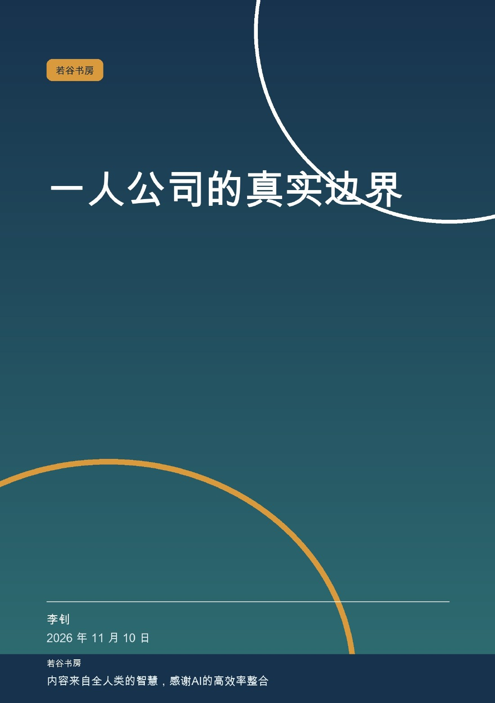
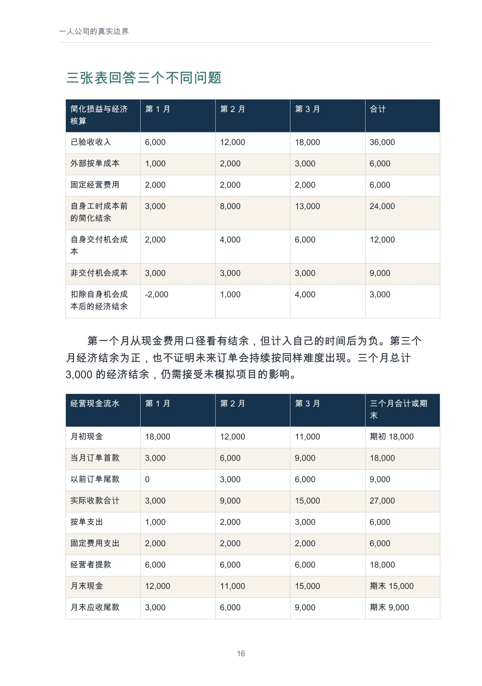
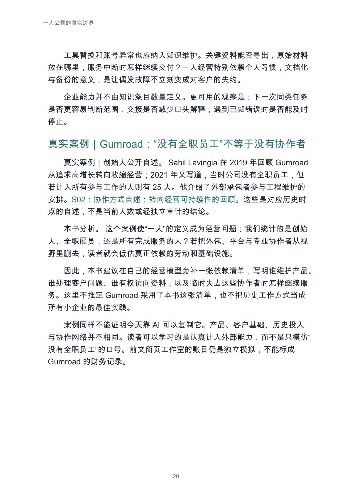
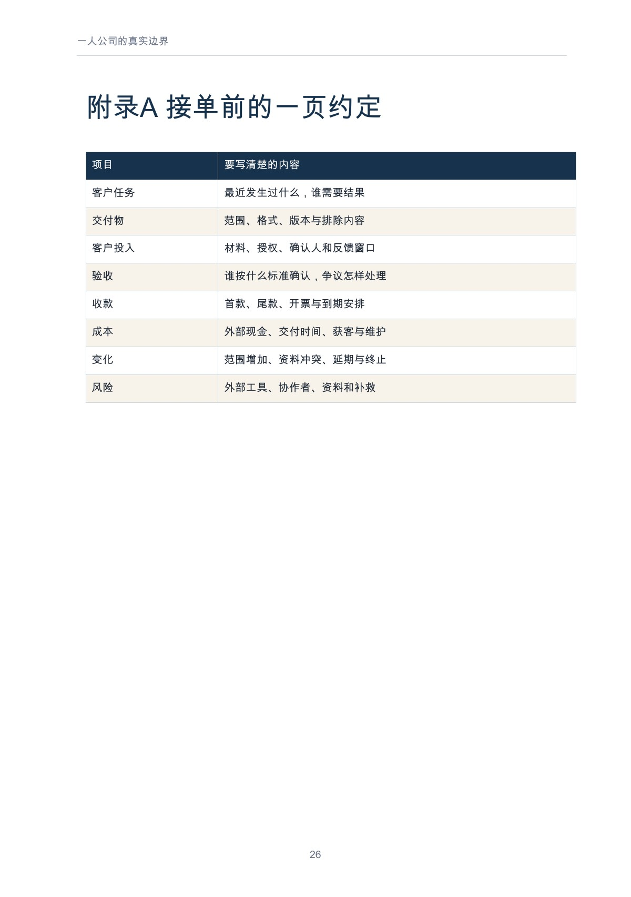

# 一人公司的真实边界

**李钊著 · 若谷书房 · 第一版 1.0 · 2026-11-10 · PDF 29 页**

小团队加 AI，可以更容易开始；需求、交付、现金和责任仍然决定一门生意能否持续。

[在线阅读全文](output/markdown/solo-company.md) · [下载 PDF](https://github.com/njxshr/ruogu-books/releases/download/a1-a3-v1.0/solo-company.pdf) · [下载 EPUB](https://github.com/njxshr/ruogu-books/releases/download/a1-a3-v1.0/solo-company.epub) · [Markdown 离线包](https://github.com/njxshr/ruogu-books/releases/download/a1-a3-v1.0/solo-company-markdown.zip)

## 这本书讨论什么

本书从找到有人愿意付款的问题开始，依次讨论报价边界、首单验证、可检查的交付、现金流、知识交接、风险与扩张条件。它关心的不是一个人能生成多少内容，而是能否反复交付客户愿意接受的结果。

原创模拟“简页工作室”串起六笔订单和三个月经营记录，分别核算收入、到账、外部成本、经营者提款与自身工时。失败分支、坏账和额外工时情景帮助读者检验：订单增加以后，经营是否真的更稳。附录提供接单约定和月度复盘入口。

## 适合谁读

独立创业者、自由职业者和小团队负责人；适合正在设计服务、报价或重新评估经营规模的人。

## 怎样阅读

| 当前需要 | 建议先读 | 带着什么问题读 |
| --- | --- | --- |
| 还没有明确服务 | [第01章　先找到有人愿意解决的问题](output/markdown/solo-company.md#user-content-第01章先找到有人愿意解决的问题)、[第02章　报价是在出售边界](output/markdown/solo-company.md#user-content-第02章报价是在出售边界)、[第03章　首单验证什么，不能验证什么](output/markdown/solo-company.md#user-content-第03章首单验证什么不能验证什么) | 先验证任务与付款，再划定报价和首单边界。 |
| 有订单却不清楚赚没赚 | [第04章　把交付做成一个可检查的过程](output/markdown/solo-company.md#user-content-第04章把交付做成一个可检查的过程)、[第05章　把账算到现金真正留下来](output/markdown/solo-company.md#user-content-第05章把账算到现金真正留下来) | 检查完整交付投入，分开看损益、机会成本和现金。 |
| 准备扩张或暂停 | [第06章　知识沉淀应减少下一次依赖](output/markdown/solo-company.md#user-content-第06章知识沉淀应减少下一次依赖)、[第07章　把不能独自承担的风险说清楚](output/markdown/solo-company.md#user-content-第07章把不能独自承担的风险说清楚)、[第08章　扩张、维持或停止](output/markdown/solo-company.md#user-content-第08章扩张维持或停止) | 检查交接、依赖与风险，明确维持、扩张或停止的条件。 |

## 完整目录

展开前言、8 章、结语与附录目录

- [前言　一人可以开始，企业仍需成立](output/markdown/solo-company.md#user-content-前言一人可以开始企业仍需成立)
- [第01章　先找到有人愿意解决的问题](output/markdown/solo-company.md#user-content-第01章先找到有人愿意解决的问题)
- [第02章　报价是在出售边界](output/markdown/solo-company.md#user-content-第02章报价是在出售边界)
- [第03章　首单验证什么，不能验证什么](output/markdown/solo-company.md#user-content-第03章首单验证什么不能验证什么)
- [第04章　把交付做成一个可检查的过程](output/markdown/solo-company.md#user-content-第04章把交付做成一个可检查的过程)
- [第05章　把账算到现金真正留下来](output/markdown/solo-company.md#user-content-第05章把账算到现金真正留下来)
- [第06章　知识沉淀应减少下一次依赖](output/markdown/solo-company.md#user-content-第06章知识沉淀应减少下一次依赖)
- [第07章　把不能独自承担的风险说清楚](output/markdown/solo-company.md#user-content-第07章把不能独自承担的风险说清楚)
- [第08章　扩张、维持或停止](output/markdown/solo-company.md#user-content-第08章扩张维持或停止)
- [结语　给生意一个可以承受的形状](output/markdown/solo-company.md#user-content-结语给生意一个可以承受的形状)
- [附录A　接单前的一页约定](output/markdown/solo-company.md#user-content-附录a接单前的一页约定)
- [附录B　每月经营复盘](output/markdown/solo-company.md#user-content-附录b每月经营复盘)
- [来源与方法说明](output/markdown/solo-company.md#user-content-来源与方法说明)
- [若谷书房](output/markdown/solo-company.md#user-content-若谷书房)

目录名称和顺序取自正式阅读版；以上链接指向 GitHub 正文的实际章节锚点。

## 实际内页预览

下列图片均直接渲染自已发布的正式 PDF，点击可放大。页码为从 1 起算、包含封面的 **PDF 文件页码**。

### 模拟经营：经济核算与现金流水对照

PDF 文件第 **16** 页。

### Gumroad 真实案例：没有全职员工仍有协作网络

PDF 文件第 **20** 页。

### 附录 A：接单前的一页约定

PDF 文件第 **26** 页。

## 案例与证据边界

Gumroad 和 Buffer 依据创始人或企业公开复盘，不属于独立财务审计；Buffer 是扩张风险的对照，并非一人公司样本。简页工作室的订单、金额、人物与工时全部为独立模拟，没有用公开案例补齐未披露账目。模拟模型不是税后利润或通用法律、税务方案。

## 阅读、下载与来源

- [Markdown 在线阅读](output/markdown/solo-company.md)
- [PDF（29 页）](https://github.com/njxshr/ruogu-books/releases/download/a1-a3-v1.0/solo-company.pdf)
- [EPUB](https://github.com/njxshr/ruogu-books/releases/download/a1-a3-v1.0/solo-company.epub)
- [Markdown 离线 ZIP](https://github.com/njxshr/ruogu-books/releases/download/a1-a3-v1.0/solo-company-markdown.zip)
- [第一版 Release](https://github.com/njxshr/ruogu-books/releases/tag/a1-a3-v1.0) · [附件 SHA-256](https://github.com/njxshr/ruogu-books/releases/download/a1-a3-v1.0/SHA256SUMS.txt)
- [来源账本](SOURCES.md) · [修订记录](REVISION_LOG.md) · [成书检查](QA_REPORT.md)
- [唯一主稿](manuscript/book.md) · [制作说明](BUILD.md) · [书房目录](../../目录.md)

## 版本与使用说明

本次仅完善介绍与实际页面预览，正文、第一版阅读成品、Release 标签和下载 URL 保持原样。公开阅读与下载不自动授予新的开放许可；第三方材料权利归原权利人所有，复用请核对书内说明及适用授权。
