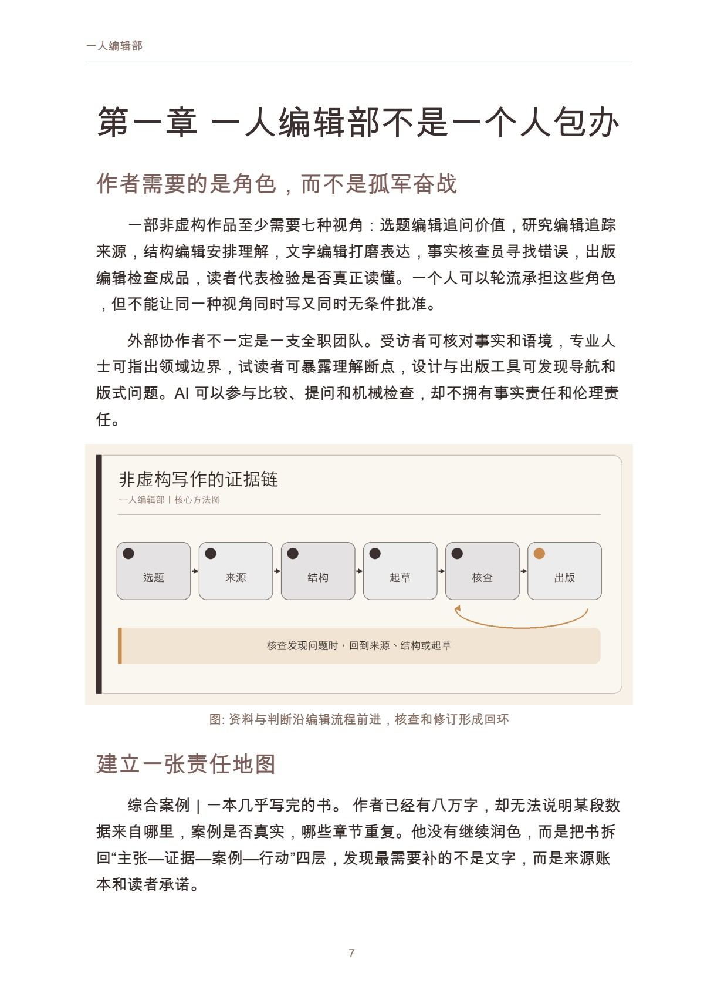
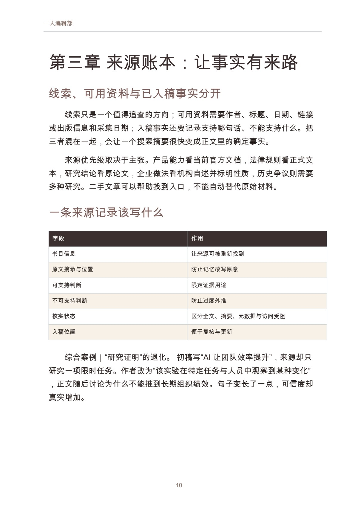

# 一人编辑部

AI 时代的非虚构写作

作者：李钊 · 出版单位：晓翊工作室  
第一版 · 原书日期：2026-11-11 · 上架日期：2026-11-11 · PDF 18 页

建立从选题、来源、采访、结构、起草、核查到出版的个人编辑系统。

## 阅读导引

一个人现在可以在很短时间内生成目录、章节、摘要和参考文献样式。写作似乎被压缩成一句要求。然而，非虚构作品真正困难的部分并没有因此消失：为什么这个问题值得写，证据能支持到哪里，受访者是否被公正呈现，章节之间是否形成理解，错误由谁发现。

“一人编辑部”不是说所有工作都由一个人亲手完成，也不是用 AI 替代编辑、受访者和读者。它是一套责任系统：作者借助工具与外部协作者，把选题、研究、结构、起草、核查和出版连接起来，并清楚知道每一次判断由谁作出。

本书以现有非虚构书稿的编辑方法为基础，给独立作者一条可复用的工作路径。它不承诺更快写完，而帮助你减少返工、虚构和无法追踪的事实。

建议先读前言与前两章，理解问题和基本方法；再结合当前问题选择后续章节，使用附录整理自己的记录。

## 完整目录

展开全书目录

- 前言　速度之外，重新理解一本书的诞生
- 第一章　一人编辑部不是一个人包办
- 第二章　选题：给读者一个可检验的承诺
- 第三章　来源账本：让事实有来路
- 第四章　采访与案例：尊重人的叙述
- 第五章　结构：安排读者的理解旅程
- 第六章　起草：把 AI 放在合适的位置
- 第七章　事实核查与交叉审校
- 第八章　修订、出版与长期维护
- 附录　一人编辑部工作模板
- 参考资料

## 实际内页预览

页码为包含封面的 PDF 文件页码，从 1 起算。

PDF 文件第 7 页：一人编辑部 7 第一章 一人编辑部不是一个人包办 作者需要的是角色，而不是孤军奋战 一部非虚构作品至少需要七种视角：选题编辑追问价

PDF 文件第 10 页：一人编辑部 10 第三章 来源账本：让事实有来路 线索、可用资料与已入稿事实分开 线索只是一个值得追查的方向；可用资料需要作者、标

## 阅读与下载

- [Markdown 在线阅读](output/markdown/一人编辑部_李钊_20261111.md)
- [PDF · 18 页](https://github.com/njxshr/ruogu-books/releases/download/new-books-20261111-v1.0/solo-editorial.pdf)
- [EPUB](https://github.com/njxshr/ruogu-books/releases/download/new-books-20261111-v1.0/solo-editorial.epub)
- [Markdown 离线包（含配图）](https://github.com/njxshr/ruogu-books/releases/download/new-books-20261111-v1.0/solo-editorial-markdown.zip)

## 来源与权利

[来源记录](SOURCES.md) · [主稿](manuscript/book.md) · [出版配置](book.json)

书中的综合案例、模拟情境和作者建议按正文标注理解，不作为真实客户成效承诺。来源记录保留原有核查范围，本次上架不代表重新核查全部外部来源。

版权所有 © 2026 李钊。保留所有权利。 第三方资料权利归原权利人。公开阅读与下载不另行授予开放许可。

[返回书目](../../目录.md)
