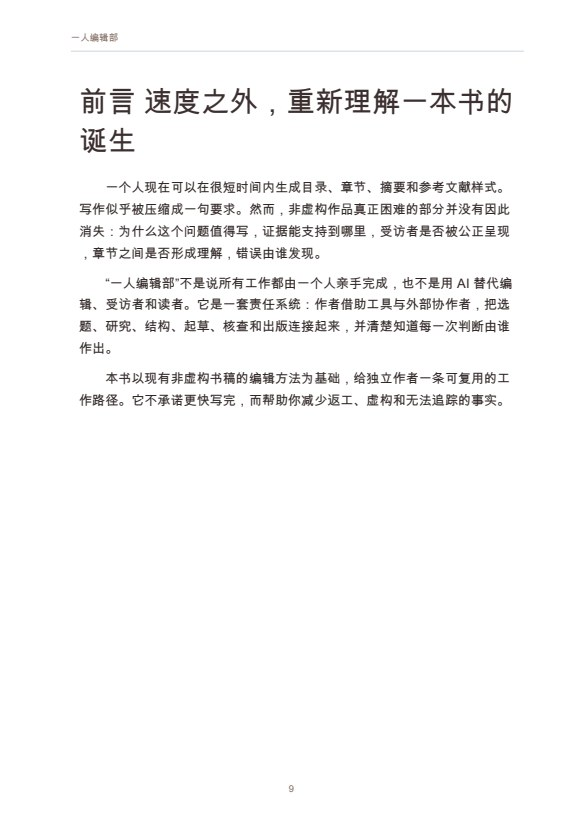
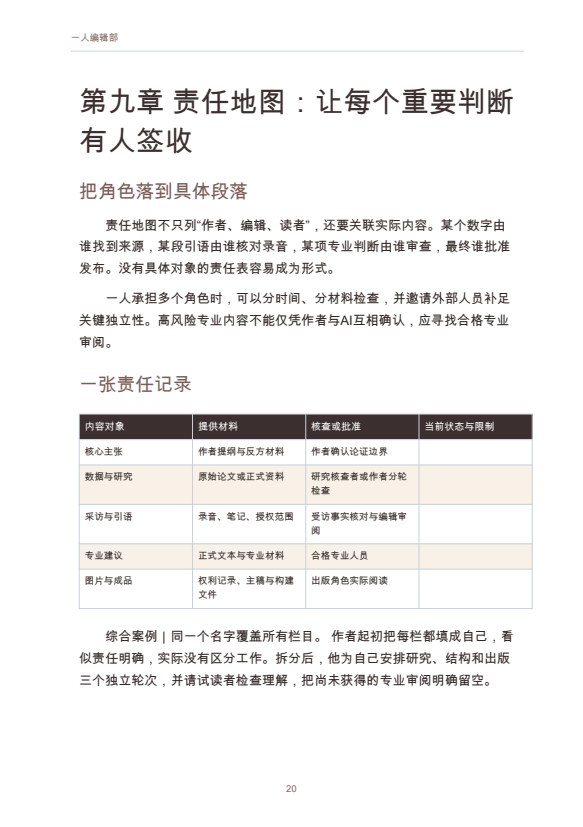

# 一人编辑部

AI 时代的非虚构写作

作者：李钊 · 出版单位：晓翊工作室  
增订版 1.1 · 原书日期：2026-11-11 · 增订日期：2026-11-19 · PDF 51 页

建立从选题、来源、采访、结构、起草、核查到出版的个人编辑系统。

## 阅读导引

本次增订保留原书基础内容、署名和出版记录，21章、7份附录。新增实践方法、综合案例或模拟练习及可直接使用的工作表。案例的材料性质以正文标注为准，不构成真实客户成效或专业结果保证。

读者可先浏览前言与原八章建立共同概念，再按当前任务选读新增章节和附录。表格需结合自己的资料填写，动态规则、产品能力和专业事项仍按当前正式来源核实。

## 完整目录

展开全书目录

- 前言　速度之外，重新理解一本书的诞生
- 第一章　一人编辑部不是一个人包办
- 第二章　选题：给读者一个可检验的承诺
- 第三章　来源账本：让事实有来路
- 第四章　采访与案例：尊重人的叙述
- 第五章　结构：安排读者的理解旅程
- 第六章　起草：把 AI 放在合适的位置
- 第七章　事实核查与交叉审校
- 第八章　修订、出版与长期维护
- 第九章　责任地图：让每个重要判断有人签收
- 第十章　来源核查：从搜索结果回到证据原文
- 第十一章　采访授权与引语核对：保留人的原意
- 第十二章　复合与模拟案例：让材料性质一眼可见
- 第十三章　结构审读：让每章增加一种新理解
- 第十四章　证据包起草：让AI只在给定材料内工作
- 第十五章　事实原子核查：逐句决定保留、限定或删除
- 第十六章　勘误与版本：让错误有去向
- 第十七章　试读与成品检查：让读者完成真实任务
- 第十八章　一章的完整编辑演练：从选题到发布
- 第十九章　外部审阅：把专业、事实与读者反馈放在正确位置
- 第二十章　图片、转述与引用权利：成品中的每一项材料都有来路
- 第二十一章　简介、摘录与传播：书外文字也要接受核查
- 附录　一人编辑部工作模板
- 附录二　来源账本与一条核查示例
- 附录三　采访与案例合并账本
- 附录四　章节结构与版本差异页
- 附录五　事实原子核查与试读记录
- 附录六　出版交付与勘误包
- 附录七　模拟章节编辑档案
- 参考资料

## 实际内页预览

页码包含封面，从 1 起算。样页由本次 51 页 PDF 重新生成。

PDF 文件第 9 页：前言。

PDF 文件第 20 页：新增实践章节。

## 阅读与下载

- [Markdown 在线阅读](output/markdown/一人编辑部_李钊_20261111.md)
- [PDF · 51 页](https://github.com/njxshr/ruogu-books/releases/download/expanded-books-20261119-v1.1/solo-editorial.pdf)
- [EPUB](https://github.com/njxshr/ruogu-books/releases/download/expanded-books-20261119-v1.1/solo-editorial.epub)
- [Markdown 离线包（含配图）](https://github.com/njxshr/ruogu-books/releases/download/expanded-books-20261119-v1.1/solo-editorial-markdown.zip)

## 增订与检查

[20 轮增订记录](REVISION_LOG.md) · [实际检查报告](QA_REPORT.md)

本次重新生成 Markdown、PDF 和 EPUB。PDF 全部 51 页已渲染并逐张查看总览；EPUB 解包读取封面、前中后章节，109 个导航目标与本地资源检查通过。具体范围与限制见报告。

## 来源与权利

[来源记录](SOURCES.md) · [主稿](manuscript/book.md) · [出版配置](book.json)

来源记录保留原有核查范围。本次扩充没有借综合案例或模拟推演新增真实访谈、客户成效和统计证据。

版权所有 © 2026 李钊。保留所有权利。第三方资料权利归原权利人。公开阅读与下载不另行授予开放许可。

[返回书目](../../目录.md)
