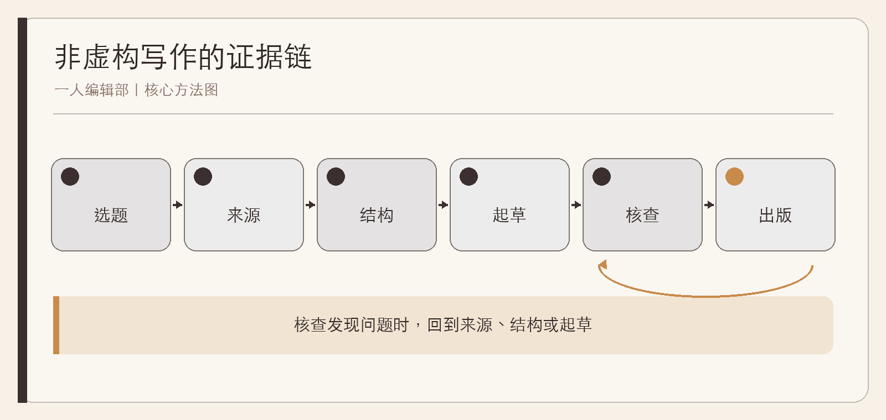

# 一人编辑部

AI 时代的非虚构写作

作者：李钊  
日期：2026 年 11 月 11 日

---

## 前言　速度之外，重新理解一本书的诞生

一个人现在可以在很短时间内生成目录、章节、摘要和参考文献样式。写作似乎被压缩成一句要求。然而，非虚构作品真正困难的部分并没有因此消失：为什么这个问题值得写，证据能支持到哪里，受访者是否被公正呈现，章节之间是否形成理解，错误由谁发现。

“一人编辑部”不是说所有工作都由一个人亲手完成，也不是用 AI 替代编辑、受访者和读者。它是一套责任系统：作者借助工具与外部协作者，把选题、研究、结构、起草、核查和出版连接起来，并清楚知道每一次判断由谁作出。

本书以现有非虚构书稿的编辑方法为基础，给独立作者一条可复用的工作路径。它不承诺更快写完，而帮助你减少返工、虚构和无法追踪的事实。

## 第一章　一人编辑部不是一个人包办

### 作者需要的是角色，而不是孤军奋战

一部非虚构作品至少需要七种视角：选题编辑追问价值，研究编辑追踪来源，结构编辑安排理解，文字编辑打磨表达，事实核查员寻找错误，出版编辑检查成品，读者代表检验是否真正读懂。一个人可以轮流承担这些角色，但不能让同一种视角同时写又同时无条件批准。

外部协作者不一定是一支全职团队。受访者可核对事实和语境，专业人士可指出领域边界，试读者可暴露理解断点，设计与出版工具可发现导航和版式问题。AI 可以参与比较、提问和机械检查，却不拥有事实责任和伦理责任。

### 建立一张责任地图

**综合案例｜一本几乎写完的书。** 作者已经有八万字，却无法说明某段数据来自哪里，案例是否真实，哪些章节重复。他没有继续润色，而是把书拆回“主张—证据—案例—行动”四层，发现最需要补的不是文字，而是来源账本和读者承诺。

责任地图至少列出：谁提出事实，谁找到原始来源，谁批准重要解释，谁检查案例授权，谁做最终发布。即使最后一栏都是作者，也要让前面的核查不只是一次自我欣赏。

### 一人编辑部的最小文件

选题定位、全书提纲、来源账本、案例账本、章节草稿、修订记录和出版母稿。文件不必复杂，但必须分工明确。聊天记录不是来源账本，输出文件夹里的多个“最终版”也不是版本管理。

## 第二章　选题：给读者一个可检验的承诺

### 从“我想写什么”到“读者能做什么”

“写一本 AI 与生活的书”只是领域。“帮助普通读者判断哪些日常决定可以自动化，哪些必须人工复核”才开始成为承诺。后者限定了读者、问题和读完后的变化，也自然排除产品参数和空泛预测。

选题定位可用六句话完成：写给谁；他们在什么处境；最常遇到什么困难；本书帮助他们完成什么；不包含什么；为什么现有材料足以支撑。最后一句能防止只有热情、没有证据的立项。

### 用样章验证，而不是用目录想象

**综合案例｜目录很完整，声音却不存在。** 作者列出二十章，每章都像百科条目。试写序章后才发现，全书没有人物、场景和核心冲突。他缩减为八章，每章回答一个具体问题，并用同一组复合人物贯穿。目录变短，书反而开始成立。

建议先写三类样章：最能代表叙事的、最能代表分析的、最能代表实操的。如果三种笔调无法共存，就需要重新定位，而不是等全部写完再统一。

### 一条反选题测试

问：删掉品牌、热词和短期数字后，本书是否仍有成立的问题？如果答案是否定的，它可能更适合一篇更新频繁的文章，而不是一本书。

## 第三章　来源账本：让事实有来路

### 线索、可用资料与已入稿事实分开

线索只是一个值得追查的方向；可用资料需要作者、标题、日期、链接或出版信息和采集日期；入稿事实还要记录支持哪句话、不能支持什么。把三者混在一起，会让一个搜索摘要很快变成正文里的确定事实。

来源优先级取决于主张。产品能力看当前官方文档，法律规则看正式文本，研究结论看原论文，企业做法看机构自述并标明性质，历史争议则需要多种研究。二手文章可以帮助找到入口，不能自动替代原始材料。

### 一条来源记录该写什么

| 字段 | 作用 |
| --- | --- |
| 书目信息 | 让来源可被重新找到 |
| 原文摘录与位置 | 防止记忆改写原意 |
| 可支持判断 | 限定证据用途 |
| 不可支持判断 | 防止过度外推 |
| 核实状态 | 区分全文、摘要、元数据与访问受阻 |
| 入稿位置 | 便于复核与更新 |

**综合案例｜“研究证明”的退化。** 初稿写“AI 让团队效率提升”，来源却只研究一项限时任务。作者改为“该实验在特定任务与人员中观察到某种变化”，正文随后讨论为什么不能推到长期组织绩效。句子变长了一点，可信度却真实增加。

### 动态事实设复核日期

价格、法规、产品功能、企业人数和实时排名都需要在交付前重新检查。账本里写明“资料截至”不是装饰，而是告诉读者事实的时间边界。

## 第四章　采访与案例：尊重人的叙述

### 采访不是为既定结论找引语

好的采访从具体经历开始：当时发生了什么，你先做了什么，遇到什么限制，哪一步与预期不同。抽象地问“你如何看待未来”，容易得到可与任何文章拼接的空话。

美国 Oral History Association 的最佳实践强调知情、语境、叙述完整性和避免操纵，同时提醒把采访中的事实性陈述与回忆的主观性区分。[OHA](https://oralhistory.org/best-practices/)

### 授权、匿名和事实核查不是一回事

匿名可以保护身份，却不会自动让细节失去可识别性。授权使用一段话，也不等于可以把话移到另一个语境。核查事实的目的，是确认时间、数字和事件，不是让受访者把叙述改成作者更喜欢的样子。

引语应能与录音、笔记或原始文件对照。协会的事实核查建议提出利用录音时间戳和转写核对，并区分轻微清理与改变语意。[AHCJ](https://healthjournalism.org/blog/2016/11/fact-checking-101-step-by-step-tips-to-check-for-errors-annotating-your-stories/)

### 复合案例必须诚实标注

**综合案例｜不是采访的“王女士”。** 作者把多个家庭的共同处境合成一个照护故事，起初写成真实采访。编辑改为“复合案例”，删去精确年龄、城市和引语，只保留方法所需的冲突。故事仍然具体，却不再借真实感获得额外权威。

真实案例、改编案例、复合案例和示例各有用途。最需要禁止的是：虚构人物说出能够证明本书观点的完美台词。

## 第五章　结构：安排读者的理解旅程

### 每章只承担一个任务

一章如果同时负责解释概念、回顾历史、比较产品、给出方法和预测未来，往往每一项都不充分。给章节写“唯一任务”：读完本章，读者应该能回答哪一个此前不会回答的问题。

常见的读者旅程是：先识别处境，再建立概念，然后学习方法，接着在案例中处理取舍，最后带走模板和下一步。顺序不必固定，但不能只按资料文件的排列拼接。

### 用问题链检查重复

**综合案例｜三章都在讲责任。** 第二章讲责任重要性，第六章讲责任重要性，第十章仍讲责任重要性。重组后，第二章解释责任如何产生，第六章讲自动执行中的权限，第十章提供责任检查表。主题没有减少，论证却开始向前。

章节之间还需要桥。上一章的结论应制造下一个问题，而不是每章都从零开始。若任意交换两章都不影响阅读，结构可能只是一组专栏。

### 案例、反例和行动的位置

案例用于展示机制，不用于替代证明；反例用于限制结论，不是装饰性“但也有风险”；行动建议必须与章内机制相连。若一个练习放到任何章都适用，它通常还不够具体。

## 第六章　起草：把 AI 放在合适的位置

### 把生成与判断分开

AI 适合协助提出反方、比较结构、发现遗漏、改写指定段落和做机械一致性检查。它不应被当作来源本身，也不应自动获得采访、人物经历和实时事实。给它材料时，要区分“可引用原文”“作者推论”“待核线索”。如果工具给出引文、论文或链接，必须回到原始材料核对；找不到原文，就不能把它作为事实依据留在稿中。

起草指令可以包含章节任务、读者、已有证据、必须覆盖的反例、禁止出现的断言和最小产出。与“写三千字”相比，这些约束更能提高质量。

### 保留作者的判断痕迹

**综合案例｜流畅但空的一章。** AI 初稿每段都通顺，却没有作者真正要主张的内容。作者删去一半抽象句，加入自己作出的三个区分：资料不等于记忆，透明不等于公平，效率不等于价值。随后才让工具检查这些区分是否前后一致。

修改时保留版本和修订理由。不要只保存越来越流畅的文字，也要保存为什么删去一个数字、为什么弱化一个结论、为什么更换一个案例。它们是下一轮的编辑记忆。

### 作者必须能复述全书

如果无法脱离稿件解释每章的问题、证据和边界，说明起草速度已经超过了理解。暂停生成，回到提纲和来源，是更节省时间的选择。

## 第七章　事实核查与交叉审校

### 核查的是句子，不是链接数量

一个段尾链接不能自动支持前面所有句子。核查应把正文拆成事实原子：人名、时间、数字、引语、因果、比较和普遍判断。每项对照来源，并记录“支持、需限定、未支持、删除”。

高风险内容需要更严格。医疗、法律、儿童、财务和安全建议不能只靠媒体转述；无法核实就明确写成假设或删去，不以“据说”“有研究”保留权威外观。

### 交叉审校寻找不同类型的问题

结构审查看章节是否重复，证据审查看结论是否越界，读者审查看概念是否能懂，文字审查看术语和句式是否一致。一次通读很难同时做好全部。

**综合案例｜链接都在，事实仍错。** 审校者发现正文把草案写成正式标准，链接确实指向官方页面，却忽略了页面上的状态。修正不是再增加一个链接，而是改变句子。核查的核心始终是证据与表述是否匹配。

### 出版前的负面检查

搜索占位符、写作提示、虚构采访、未标案例、孤立标题、失效图片和错误目录。再抽查前、中、后各一章，避免只修开头。

## 第八章　修订、出版与长期维护

### 修订按正确顺序进行

先结构，再论证，再读者体验，再逐句，最后出版。若一章可能被删除，就先不要花两小时修饰句子。每轮只解决一类问题，并在修订记录里写下实际变化。

出版母稿应唯一。草稿、研究笔记和输出文件分开，避免旧稿反向覆盖新稿。Markdown、PDF、EPUB 只是同一内容的不同呈现，不能各自手工改成不同版本。

### 成品也属于事实的一部分

书名、作者、日期、目录、图表、来源链接和页码都需要检查。PDF 要逐页渲染，EPUB 要检查导航与重排，Markdown 要确认图片路径和完整内容。构建成功不等于没有裁切、空白页和断章。

### 给下一版留下入口

记录动态事实的复核日期、读者勘误、待补研究和已放弃路线。设置可找到的勘误入口，并按影响分级处理：文字误排可进入下一版，影响事实理解或行动安全的重要错误应尽快修正当前电子版、更新版本记录并说明变化。出版不是让书从此不变，而是让当前版本有清楚边界，下一版知道从哪里继续。

一人编辑部最终带来的不是“一个人可以做所有事”的幻觉，而是一种更可靠的自由：你知道哪些环节可以加速，哪些判断不能外包，也能向读者说明这本书为何值得信任。

## 第九章　责任地图：让每个重要判断有人签收

### 把角色落到具体段落

责任地图不只列“作者、编辑、读者”，还要关联实际内容。某个数字由谁找到来源，某段引语由谁核对录音，某项专业判断由谁审查，最终谁批准发布。没有具体对象的责任表容易成为形式。

一人承担多个角色时，可以分时间、分材料检查，并邀请外部人员补足关键独立性。高风险专业内容不能仅凭作者与AI互相确认，应寻找合格专业审阅。

### 一张责任记录

| 内容对象 | 提供材料 | 核查或批准 | 当前状态与限制 |
| --- | --- | --- | --- |
| 核心主张 | 作者提纲与反方材料 | 作者确认论证边界 |  |
| 数据与研究 | 原始论文或正式资料 | 研究核查者或作者分轮检查 |  |
| 采访与引语 | 录音、笔记、授权范围 | 受访事实核对与编辑审阅 |  |
| 专业建议 | 正式文本与专业材料 | 合格专业人员 |  |
| 图片与成品 | 权利记录、主稿与构建文件 | 出版角色实际阅读 |  |

**综合案例｜同一个名字覆盖所有栏目。** 作者起初把每栏都填成自己，看似责任明确，实际没有区分工作。拆分后，他为自己安排研究、结构和出版三个独立轮次，并请试读者检查理解，把尚未获得的专业审阅明确留空。

### 签收不等于放弃后续纠错

批准后仍可能发现错误。责任地图应附勘误入口和更新责任，避免大家把签收当作不再阅读的理由。发现重要问题时，先评估影响并修正当前版本，再追查流程缺口。

## 第十章　来源核查：从搜索结果回到证据原文

### 先定位支持句，再打开材料

核查从一个具体句子开始。标出其中的人名、时间、数字、因果、比较和适用范围，再寻找能够支持这些要素的原始材料。搜索摘要和AI答案可以帮助定位，不能替代实际阅读。

获得资料后，记录阅读到的是全文、摘要、元数据还是搜索片段。访问受阻就写受阻，不能把标题或摘要扩展成全文结论。动态事实保存访问日期，后续再版重新检查。

### 一次来源追踪

| 步骤 | 留下什么 |
| --- | --- |
| 拆解主张 | 需要分别支持的事实原子 |
| 找到原始资料 | 作者、标题、版本、链接或出版信息 |
| 阅读相关部分 | 原文摘录、页码或段落位置 |
| 判断边界 | 能支持、需限定、不能支持的内容 |
| 改写正文 | 与证据强度和范围相符的句子 |
| 保存记录 | 入稿位置、核查人和日期 |

**综合案例｜“研究证明”的缩句。** 初稿用一项特定任务研究支持普遍组织效率，核查者把正文改为该研究实际观察的任务和人群，并删除长期绩效承诺。保留的链接没有变，句子的权力变小了，可信度反而提高。

### 来源冲突时不做简单投票

两份资料不一致，先比较时间、定义、样本、方法和利益关系。数量多不自动代表更可靠，转载同一材料也不能算独立印证。无法解决时保留分歧、缩小结论或暂缓发布。

## 第十一章　采访授权与引语核对：保留人的原意

### 采访前谈清楚材料怎样使用

说明作品主题、使用渠道、可能的编辑方式、录音与笔记保存、匿名安排和可撤回范围。具体同意形式按适用规则与采访情境确定，不把一次愿意聊天自动解释为同意公开所有内容。

涉及敏感经历、第三方信息或权力不对等时，要额外评估公开后影响。受访者可以核对事实和自身表达，但作者不能用核查机会施压其改变真实记忆或立场。

### 引语的三次对照

第一次对照录音或原始笔记，确认文字没有听错；第二次对照上下文，确认删减没有逆转含义；第三次对照成稿，确认引语周围的事实和作者解释没有借受访者背书。

| 引语状态 | 可以怎样处理 |
| --- | --- |
| 逐字引语 | 保留原话，必要清理不得改变语意 |
| 概括转述 | 不加引号，明确这是作者整理 |
| 回忆与意见 | 作为个人叙述呈现，事实另行核查 |
| 无法找到原始记录 | 不作确定引语，补核或删除 |
| 超出授权范围 | 不使用，重新取得适当同意 |

**综合案例｜一句话被挪到另一章。** 作者把受访者谈个人选择的句子放到组织趋势论证中，读者会误以为对方支持作者结论。编辑将引语放回原事件，并把趋势判断明确留给作者与其他证据。

### 匿名仍需检查组合识别

删除姓名后，城市、职位、时间和特殊事件组合仍可能识别个人。编辑要检查细节是否都必要，并与受访者讨论风险。不能为了故事生动保留无关的身份线索。

## 第十二章　复合与模拟案例：让材料性质一眼可见

### 先决定案例承担什么工作

案例可以解释机制、展示练习或呈现取舍，不能凭虚构细节证明真实效果。写作前标明它是真实记录、获授权改编、多个来源合成的复合案例，还是完全用于演练的模拟情境。

复合案例来自多个真实材料时，要检查合成是否制造不存在的人物经历和因果关系。完全模拟的案例不需要伪造年龄、城市、公司数据或“当事人说”来增加可信外观，保留练习所需条件即可。

### 案例账本

| 字段 | 需要记录的内容 |
| --- | --- |
| 类型与标签 | 真实、改编、复合、模拟或纯示例 |
| 材料来源 | 授权材料、公开来源或作者设计 |
| 使用目的 | 解释机制、练习或边界 |
| 不能证明 | 不作普遍效果、真实访谈或统计证据 |
| 隐私与权利 | 识别风险、授权和必要删减 |
| 入稿位置 | 章节、版本与复核日期 |

**综合案例｜删去过分完美的引语。** 一个复合人物原本说出恰好证明全书观点的话。编辑删掉这句引语，把案例改为情境与动作描述，并明确它由常见处境合成。故事仍能帮助练习，却不再冒充真实见证。

### 全文统一案例称谓

同一人物不能在一章是复合案例，在另一章变成采访对象。搜索姓名、案例类型和“采访、证明、用户反馈”等词，检查前后一致。封面、简介和宣传材料也不能比正文更确定。

## 第十三章　结构审读：让每章增加一种新理解

### 先做章节功能清单

把每章的唯一任务、核心主张、主要证据、案例类型和读者动作列在一页。相邻章节若使用同一材料、回答同一问题，应考虑合并或重新分工。结构问题在删改句子之前解决。

章节顺序可以用读者需要检验：先理解哪个概念，后面才有能力判断；哪个案例能改变下一步行动；哪些附录适合在需要时使用。资料获得顺序不必成为读者阅读顺序。

### 重复与断点检查

| 检查发现 | 可能的结构调整 |
| --- | --- |
| 多章都在说明重要性 | 合并论证，把后续章改为方法或边界 |
| 一个概念反复从头解释 | 首次定义，后文承接并链接 |
| 案例与主张没有联系 | 删除、换例或重写要讨论的机制 |
| 中途突然出现专业要求 | 提前交代适用条件与专业责任 |
| 结尾只重复口号 | 回到全书承诺、证据限制和行动 |

**综合案例｜三章责任。** 作者把“责任很重要”从三章重复论述中拆出，分别改为何时形成责任、自动执行怎样授权、出版前如何签收。主题仍在，各章却不再可以任意交换。

### 给章节之间写桥

桥可以是一句由上一章结论引出的新问题，也可以是一个案例的条件变化。它不需要预告所有内容，只要让读者理解为何此刻进入下一章。写不出桥时，回到功能清单检查顺序。

## 第十四章　证据包起草：让AI只在给定材料内工作

### 先给材料分级

起草前把材料分为可引用原文、作者推论、待核线索和禁止公开内容。每份材料附来源编号与使用边界。AI收到的内容需要完成任务即可，敏感原始资料不应因方便而全部输入。

章节指令写清唯一任务、读者、必须支持的句子、不可越过的结论和需要保留的反例。生成后先检查是否引入新材料、人物、数字和引语，再处理语言。

### 起草前后对照

| 检查 | 起草前 | 生成后 |
| --- | --- | --- |
| 章节任务 | 读者完成后能做什么 | 是否仍围绕同一任务 |
| 事实范围 | 哪些材料允许使用 | 是否出现来源外事实 |
| 案例性质 | 真实、复合或模拟 | 是否被改成真实见证 |
| 结论强度 | 可支持与不可支持 | 是否出现必然、普遍和证明 |
| 作者判断 | 核心区分与取舍 | 是否被通用表达冲淡 |

**综合案例｜流畅稿里多出一条研究。** 生成文本加入作者未提供的论文标题和数字。作者没有因它看起来合理就保留，而是标为未核线索；无法找到原始材料后删除，并补查其余段落是否也有来源外添加。

### 保留可追溯的版本

保存指令材料范围、生成稿、作者修改和核查结果。版本记录不必收录每次击键，但要能解释重要结论为何改变。下一版因此可以重走证据路径，而非只有一份顺滑终稿。

## 第十五章　事实原子核查：逐句决定保留、限定或删除

### 一段文字可能需要多种证据

“某产品在某年推出并因此占据市场”至少包含时间、事件和因果三层。一个官方页面可能只支持前两项。核查者应分别标注，不能因段尾有一个链接就整段通过。

优先检查会影响读者行动和人物声誉的内容，再检查普通书目信息与文字。无法核实的重要事实可删除、弱化或标为待核，但正式出版稿不应堆满未处理待核标记。

### 核查结果四种状态

| 状态 | 处理方式 |
| --- | --- |
| 支持 | 来源直接覆盖句子要素与范围 |
| 需限定 | 缩小人群、时间、任务或因果 |
| 未支持 | 更换证据或删除对应内容 |
| 有争议 | 呈现合理分歧和各自依据，避免唯一化 |

**综合案例｜草案被写成正式标准。** 核查者打开官方页面后发现项目状态仍在草案流程。正文改为“草案提出”，删除“正式实施要求”，并在来源账本记录检查日期。修正来自阅读状态，而非再补一条无关链接。

### 核查后还要回读段落

逐句缩小结论后，段落逻辑可能断裂。回读确认剩余句子仍能支持作者主张，必要时重写结构。不能让每句单独看似谨慎，合起来仍暗示同一个过强结论。

## 第十六章　勘误与版本：让错误有去向

### 按影响决定处理速度

文字误排、链接失效、事实错误和可能改变行动安全的重要错误，需要不同响应。高影响错误先限制传播、修正当前电子版并清楚说明，随后处理关联格式、目录和宣传内容。

读者报告应保存原句、版本、报告日期和核查依据。报告者提供线索，不等于其说法自动正确；编辑仍需回到原始材料。无法立即判断时说明处理状态，不静默删除争议。

### 一次勘误闭环

| 阶段 | 必要动作 |
| --- | --- |
| 收到 | 确认版本、位置与具体主张 |
| 核查 | 找到原始资料并记录不同意见 |
| 修正 | 修改唯一主稿和必要的当前发布说明 |
| 重建 | 同步Markdown、PDF、EPUB及离线包 |
| 验证 | 检查原错误和所有受影响位置 |
| 记录 | 写明版本、日期、影响与仍未解决事项 |

**综合案例｜正文改了，宣传页没改。** 作者把一项过强效果结论从主稿删除，却发现书籍简介仍保留旧句。后续勘误流程把简介、目录和附件纳入影响检查，避免读者从外围材料获得过期承诺。

### 版本号服务于读者识别

每次重要发布记录日期和变化，读者才能知道自己看到的是哪一版。保留历史出版记录，不用新日期覆盖最初创作与发布；重新构建文件也不等于重新采访或重新核验所有来源。

## 第十七章　试读与成品检查：让读者完成真实任务

### 试读不只为收集赞美

可以根据书籍承诺设计任务：找到一项方法、解释一个限制、完成一张表格或指出不适用情境。观察读者在哪里停顿、误解或需要作者口头补充，比“觉得怎么样”更容易转化为修订。

试读者选择应覆盖目标读者的不同经验。少数试读不能代表全部读者，作者应保存具体任务和观察，不把反馈写成普遍满意率。

### 从口头补救回到主稿

**综合案例｜读者找不到退出条件。** 方法章写得很完整，试读者却不知道何时应停止使用。作者口头解释后，把该条件补回章节开头和检查表，再让另一位读者尝试。问题由成品结构解决，而不是依赖作者在场。

| 试读任务 | 实际观察 | 主稿或版式修订 | 复测结果 |
| --- | --- | --- | --- |
| 找到核心方法 |  |  |  |
| 解释适用边界 |  |  |  |
| 使用工作表 |  |  |  |
| 完成下载与导航 |  |  |  |

### 三种格式分别验收

Markdown检查文字、图片与相对链接；PDF逐页检查裁切、表格、代码和异常分页；EPUB解包检查导航、资源，并在可用环境查看重排。构建成功只证明文件生成，不能替代这些阅读。

## 第十八章　一章的完整编辑演练：从选题到发布

### 模拟背景

以下为**模拟综合演练**，不对应真实出版项目或读者成效。作者准备写一章“个人知识库的过期问题”，读者目标是能识别并处理一条旧知识。已有材料包括三条公开文档笔记、一张作者流程草图和两个明确标注的模拟情境。

作者先写章节卡和来源账本，发现初稿想同时讨论知识管理、AI、隐私和全部组织理论，超出本章承诺。缩减后，本章只处理“怎样判断旧知识是否仍可使用”，其他主题只留必要边界。

### 从证据到成稿

研究轮次中，作者为每条动态资料记录日期和可支持句。一个搜索结果找不到原文，被移出事实依据。模拟情境用于练习识别过期与权限，不写人物引语，也不添加虚构提升比例。

结构轮次先安排识别信号，再讲处理动作，最后给出练习。起草后，事实核查发现一句“归档即可阻止AI使用”缺少产品依据，改为分别检查索引、缓存与权限。试读者随后完成一条模拟旧条目处理，指出“复核”与“上传时间”混淆，作者补入实质复核定义。

| 轮次 | 留下的实际记录 | 未解决边界 |
| --- | --- | --- |
| 选题与来源 | 章节卡、来源账本、未使用线索 | 动态资料需后续复核 |
| 结构与起草 | 版本差异、案例标签 | 只覆盖一种任务 |
| 核查与试读 | 原子核查表、读者任务观察 | 少数试读不能代表全部 |
| 出版 | 唯一主稿、三格式检查与发布记录 | 未声称覆盖所有阅读器 |

### 演练结束时仍有未完成项

作者把动态资料复核和另一类读者试读列入下一版，而没有标记全部完成。这个结尾体现了一人编辑部的基本纪律：完成当前承诺，同时诚实保留尚未执行的工作。

## 第十九章　外部审阅：把专业、事实与读者反馈放在正确位置

### 不同审阅不能相互代替

专业审阅判断特定领域的适用条件与风险，事实核查确认来源和句子是否匹配，试读检验目标读者能否理解与使用。三种角色有时会重叠，但一个流畅读者的认可不能证明医学或法律结论，专业人士的审阅也不自动保证普通读者读得懂。

邀请前应提供明确范围：需要审阅哪些章节、什么类型问题、材料截止时间、期望返回形式和公开署名方式。让对方知道哪些是作者推论，哪些已有正式来源，避免用整本书的模糊请求转移全部责任。

### 审阅意见的处理记录

| 意见位置 | 类型与依据 | 作者处理 | 需要再次确认 |
| --- | --- | --- | --- |
| 事实错误 | 原始材料与具体句子 | 修正、补证或删除 | 修改后句子及关联段落 |
| 专业边界 | 适用规则、风险或例外 | 缩小范围、增加正式求援 | 合格审阅者或正式流程 |
| 结构理解 | 读者任务与卡点 | 调整顺序、定义或示例 | 另一位读者实际任务 |
| 表达偏好 | 风格与作者选择 | 保留、调整并说明理由 | 不必全部采纳 |

**综合案例｜相互冲突的两条意见。** 一位审阅者希望增加更多专业术语，试读者则表示同一概念难以理解。作者先确认术语是否确有必要，再在首次出现处给出简明定义和例子，保留必要精度。处理不是选择职位更高的人，而是分别回应准确性与理解任务。

### 作者仍要说明最终选择

外部意见可以被讨论和拒绝，但重要分歧要留下理由。署名或感谢不应暗示对方为全书所有内容背书，尤其当他们只审阅了某一章或某一版本。修改范围扩大后，需要判断是否再次审阅。

## 第二十章　图片、转述与引用权利：成品中的每一项材料都有来路

### 图片来源和图片说明分别核查

一张图片能否使用，需要看作者、授权、来源、修改范围和必要署名；图片能否支持正文，则要看它实际呈现的内容。拥有下载链接不等于获得使用权，视觉上相关也不等于证据可靠。

AI 生成图片同样需要记录生成方式、用途和必要检查，不把它当作某真实事件的照片。人物、商标、隐私和受保护元素可能带来额外问题，应按具体规则与专业意见处理。

### 一张材料权利卡

| 字段 | 需要记录的内容 |
| --- | --- |
| 材料与来源 | 文件、创作者、原始页面或生成方式 |
| 使用依据 | 授权、许可、合理依据或自行创作 |
| 允许修改 | 裁切、翻译、改编与署名要求 |
| 事实性质 | 真实记录、示意图、模拟或艺术表达 |
| 隐私与第三方 | 人物、地点、数据和隐藏信息 |
| 入稿位置 | 章节、图注、版本与复核日期 |

**综合案例｜示意图被当成现场。** 作者为某流程制作合成示意图，初版图注写“项目现场”，容易让读者误以为真实记录。编辑改为“流程示意”，并删除与真实机构相似的标识。图片仍可解释方法，材料性质不再含混。

### 转述也保留来源和责任

改写一段文字不会自动消除来源关系，也不保证事实准确。转述应回到原始材料理解，不把多个来源拼接成无人表达过的确定结论。引用长度、许可和学术规范按作品情境与适用要求处理。

出版前逐图、逐表和逐条引语检查来源记录，确认离线包内的文件与正文一致。无法说明使用依据或支持内容的材料，应替换、删除或暂缓发布，不能用精美排版掩盖缺口。

## 第二十一章　简介、摘录与传播：书外文字也要接受核查

### 简介不能替正文作出更大的承诺

作品完成后，书名页、销售页简介、推荐语、社交摘录和分享图片会继续改写读者对内容的理解。正文谨慎限定的方法，到了简介里可能变成“彻底解决”；复合案例中的情节，到了传播图里可能被称作真实故事。传播文字篇幅更短，核查标准却不能因此消失。

编辑可以把所有对外文字视为同一本书的衍生版本。它们应回到唯一主稿和来源账本，检查书名、作者、读者承诺、案例性质、数据、引语与适用边界。宣传有吸引力，与作出没有依据的保证之间仍有清楚分界。

### 一张传播材料对照表

| 材料 | 容易发生的偏移 | 发布前核对 |
| --- | --- | --- |
| 书籍简介 | 把帮助写成保证，把范围写成全能 | 读者承诺与不包含事项 |
| 推荐语 | 暗示推荐者审阅全书或证明效果 | 实际阅读范围、原话与授权 |
| 内容摘录 | 脱离上下文后逆转原意 | 前后段、条件与案例标签 |
| 分享图片 | 为醒目删去限定词和来源 | 完整句意、出处和图片权利 |
| 访谈与播客提纲 | 把作者观点说成公认事实 | 主张依据、分歧与口头纠正方式 |
| 更新公告 | 只写新增，不说明重要修正 | 版本、影响与旧版读者入口 |

**综合案例｜被截短的一句话。** 某书原句为“在来源可追溯、风险可控的有限任务中，这套方法可以减少返工”，分享图只保留“这套方法可以减少返工”。编辑发现后补充适用条件，并在图片说明中给出章节位置。截图传播更广，也不能让原句失去原有边界。

### 推荐语与读者反馈不借来作证

邀请推荐时说明作品版本、阅读范围和引用方式。对方只读样章，就不能把感谢语处理成全书专业审定；读者分享个人体验，也不能据此推断普遍成效。未经许可的私信反馈不直接公开，匿名处理仍需检查组合识别。

若不同推荐语存在意见分歧，不必拼接成一致赞美。作者可以选择与本书真实内容相符的评论，也可以在介绍中保留合理争议。书籍的可信度来自读者能够核对的内容，不来自一排权威姓名。

### 给传播材料也安排版本与勘误

每次重要修订后，检查在线简介、目录页、预览图、摘录和下载说明是否仍与当前主稿一致。记录哪些渠道能够更新、哪些旧截图可能继续流传；重要事实错误需要及时发布更正，并提供可找到的当前版本。

**模拟演练｜一次同步更新。** 作者删除正文中一条无法核实的效果数字后，继续检查书籍简介、分享图、自动回复和旧发布说明。其中两处仍含旧数字，于是同步替换并记录日期。尚未更新的外部转载列为联系事项，不写成已经全部修正。

传播的最后一轮核查，可以由一个只看书外材料的人完成：仅凭简介和摘录，他会形成什么期待，能否找到来源、版本与完整作品。若这些材料迫使正文承担更大的承诺，应修改传播文字，让书外与书内重新一致。

## 附录　一人编辑部工作模板

### 选题卡

读者与处境；读者问题；本书承诺；不包含；核心材料；主要反方；动态事实；样章计划。

### 章节卡

唯一任务；核心问题；关键主张；来源编号；案例类型；反例或边界；最小行动；与下一章的桥。

### 核查单

1. 每个数字、日期、引语能否回到原始材料？
2. 每个“证明、导致、普遍、必然”是否超过证据？
3. 真实、改编、复合与示例是否明确区分？
4. 动态信息是否有采集日期与复核日期？
5. 作者是否能脱稿复述本章论证？

### 出版记录

母稿版本；本次结构与事实修订；图片与授权；构建日期；PDF 页数；逐页检查结果；EPUB 导航检查；已知问题；下一版复核项。

## 附录二　来源账本与一条核查示例

### 来源账本字段

| 编号 | 原始资料与位置 | 实际阅读范围 | 支持句 | 不能支持 | 入稿与复核 |
| --- | --- | --- | --- | --- | --- |
|  |  | 全文／部分／摘要／元数据 |  |  |  |
|  |  |  |  |  |  |
|  |  |  |  |  |  |

链接旁写访问日期和版本，纸质书写版本与页码。网页正文变化后，旧摘录仍属于当时的核查记录，再版需重新确认。转载和搜索摘要只作线索时，状态应明确，不能冒充已读原文。

### 模拟核查示例

以下为**模拟编辑记录**，不对应新增真实研究。初稿写“该工具让所有团队效率翻倍”，来源材料实际只描述某机构在限定任务中的一次公开做法。核查者把普遍效果句删除，改为“该机构公开材料介绍了其在特定任务中的做法”，并注明机构自述不能证明普遍成效。

| 核查动作 | 留下的记录 |
| --- | --- |
| 拆出主体、范围、因果和数字 | “所有团队”“翻倍”“由工具导致”需要分别支持 |
| 回到公开材料 | 只见特定任务做法，未见普遍效果和独立评估 |
| 修改正文 | 删除数字和普遍因果，保留材料能支持的介绍 |
| 检查段落后的推论 | 后续行动建议不再以翻倍收益为前提 |
| 登记下一版 | 动态产品能力与机构页面需重新访问 |

## 附录三　采访与案例合并账本

### 采访记录

- 受访者与联系授权范围：
- 采访日期、方式和原始文件位置：
- 录音、笔记与转写的保存权限：
- 可公开姓名、身份和引语范围：
- 需要匿名或删除的组合识别细节：
- 事实核对与语境核对的分别结果：
- 不能进入公开稿件的第三方材料：

授权、匿名和事实核查分别记录。受访者的个人回忆可以作为叙述呈现，其中可验证的事件、日期和他人信息仍需适当核查。没有原始记录支持的句子不使用逐字引号。

### 案例标签检查

| 案例位置 | 类型 | 材料基础 | 可以展示 | 不能证明 |
| --- | --- | --- | --- | --- |
|  | 真实／改编／复合／模拟 |  |  |  |
|  |  |  |  |  |

搜索人物姓名与“采访、客户、用户证明、效果显著”等词，确保简介、正文、图注和宣传文案没有相互冲突。模拟情境不写虚构当事人引语，复合案例不合并成可识别的真实个人。

## 附录四　章节结构与版本差异页

### 全书章节地图

| 章节 | 唯一任务 | 新证据或新方法 | 与前后章的关系 | 重复处理 |
| --- | --- | --- | --- | --- |
|  |  |  |  |  |
|  |  |  |  |  |
|  |  |  |  |  |

若两章的唯一任务和主要材料相同，先调整结构，再润色。章节地图还能暴露某章没有任何证据、连续多章只有抽象议论或所有案例都完美支持作者的情况。

### 重要修改的追踪

| 版本与位置 | 实际变化 | 修改原因与证据 | 影响到的其他内容 |
| --- | --- | --- | --- |
|  |  |  |  |
|  |  |  |  |

影响栏包括目录、交叉引用、简介、图注、来源列表、宣传材料及三种出版格式。重要事实修改不能只留一句“优化表达”，应说明原句为何不准确以及怎样处理。

## 附录五　事实原子核查与试读记录

### 核查页

| 正文位置与事实原子 | 来源位置 | 支持／限定／未支持／争议 | 处理与复核 |
| --- | --- | --- | --- |
|  |  |  |  |
|  |  |  |  |
|  |  |  |  |

核查完成后回读整段，确认被弱化的句子没有在新的组合中重新产生过强暗示。医疗、法律、财务、儿童、安全和其他专业内容，需要相应正式资料与合格审阅。

### 试读任务页

给试读者一个与本书承诺直接相关的任务，记录其实际动作，不先解释。可以要求找到方法、复述边界、完成表格或说明何时求助。作者口头补救的每一处都进入主稿修订候选。

| 任务 | 读者实际完成与卡点 | 修改 | 复测 |
| --- | --- | --- | --- |
|  |  |  |  |
|  |  |  |  |

少数试读只代表这些任务与参与者，不写成满意率或普遍效果。未执行复测的项目保留“未执行”，不能因文字已改便自动标记读者已理解。

## 附录六　出版交付与勘误包

### 出版交付

1. 唯一主稿与书籍配置的作者、书名、日期和版本一致。
2. 来源与案例账本中的未处理项已经删除、解决或明确留在下一版计划。
3. Markdown正文、图片和相对链接完整，离线包实际打开。
4. PDF逐页查看封面、目录、正文、表格、代码、附录与来源，检查裁切和异常空白。
5. EPUB解包检查导航、锚点、本地资源，并读取封面、首中末章。
6. 阅读入口指向当前发布版本，旧附件没有被无意覆盖或删除。
7. 校验和按最终文件生成，发布记录只写实际完成的检查。

### 勘误记录

| 字段 | 填写内容 |
| --- | --- |
| 读者报告与原版本 |  |
| 原句、位置与可能影响 |  |
| 原始证据和不同意见 |  |
| 主稿、简介与关联材料修改 |  |
| 三格式重建与复测 |  |
| 发布日期、说明和未解决事项 |  |

影响行动安全或人物权益的重要错误，应优先处理当前版本与传播范围。普通文字问题可以进入计划修订，但也要保留记录。静默改稿而不更新版本，会让读者难以确认自己看到的内容。

## 附录七　模拟章节编辑档案

以下为**模拟档案摘要**，用于展示完整记录方式。章节主题是“识别一条过期知识”，没有真实采访或读者成效。

| 编辑对象 | 本次材料 | 编辑结论 |
| --- | --- | --- |
| 章节承诺 | 读者能处理一条模拟旧条目 | 删除泛论全部知识管理的段落 |
| 来源 | 三条公开文档笔记与访问日期 | 搜索摘要未入稿，动态内容留下复核日期 |
| 案例 | 两个模拟情境 | 不写人物引语和虚构效果数字 |
| 事实核查 | 一处“归档即可阻止AI使用” | 改为分别检查索引、缓存与权限 |
| 试读 | 一位模拟读者角色的任务记录 | 补充上传时间与实质复核的区别 |
| 出版 | 主稿、版本差异和交付清单 | 未执行的实体阅读器检查保持未执行 |

这份档案说明记录怎样互相连接：章节承诺决定材料，材料限制主张，核查改变句子，试读改变结构，出版检查确认改变确实进入成品。任何一步没有开展，就在相应位置留空并写明后续责任。

## 参考资料

1. Oral History Association：[Oral History Best Practices](https://oralhistory.org/best-practices/)。
2. Association of Health Care Journalists：[Fact-checking 101](https://healthjournalism.org/blog/2016/11/fact-checking-101-step-by-step-tips-to-check-for-errors-annotating-your-stories/)，2016。
3. 李钊：《Neo Lab：AI 原生组织的崛起》编辑契约与来源账本，2026。
4. 李钊：《销售与售前分析工具全书》修订版编辑规范，2026。
5. 李钊：《道德经新解》编辑简报与共享考据来源，2026。
6. 本书配套项目中的选题定位、全书提纲、素材库与来源总账模板。

资料收集截至 2026 年 11 月 11 日。采访规范、平台功能与出版工具在后续使用时应重新核对。
