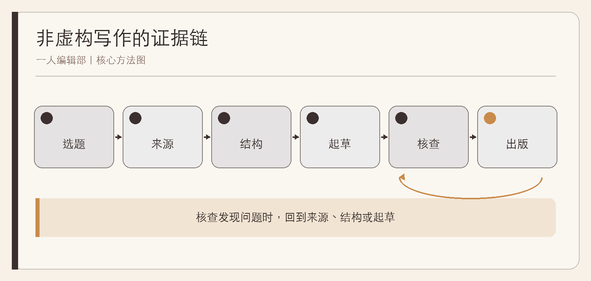

# 一人编辑部

AI 时代的非虚构写作

作者：李钊  
日期：2026 年 11 月 11 日

---

## 前言　速度之外，重新理解一本书的诞生

一个人现在可以在很短时间内生成目录、章节、摘要和参考文献样式。写作似乎被压缩成一句要求。然而，非虚构作品真正困难的部分并没有因此消失：为什么这个问题值得写，证据能支持到哪里，受访者是否被公正呈现，章节之间是否形成理解，错误由谁发现。

“一人编辑部”不是说所有工作都由一个人亲手完成，也不是用 AI 替代编辑、受访者和读者。它是一套责任系统：作者借助工具与外部协作者，把选题、研究、结构、起草、核查和出版连接起来，并清楚知道每一次判断由谁作出。

本书以现有非虚构书稿的编辑方法为基础，给独立作者一条可复用的工作路径。它不承诺更快写完，而帮助你减少返工、虚构和无法追踪的事实。

## 第一章　一人编辑部不是一个人包办

### 作者需要的是角色，而不是孤军奋战

一部非虚构作品至少需要七种视角：选题编辑追问价值，研究编辑追踪来源，结构编辑安排理解，文字编辑打磨表达，事实核查员寻找错误，出版编辑检查成品，读者代表检验是否真正读懂。一个人可以轮流承担这些角色，但不能让同一种视角同时写又同时无条件批准。

外部协作者不一定是一支全职团队。受访者可核对事实和语境，专业人士可指出领域边界，试读者可暴露理解断点，设计与出版工具可发现导航和版式问题。AI 可以参与比较、提问和机械检查，却不拥有事实责任和伦理责任。

### 建立一张责任地图

**综合案例｜一本几乎写完的书。** 作者已经有八万字，却无法说明某段数据来自哪里，案例是否真实，哪些章节重复。他没有继续润色，而是把书拆回“主张—证据—案例—行动”四层，发现最需要补的不是文字，而是来源账本和读者承诺。

责任地图至少列出：谁提出事实，谁找到原始来源，谁批准重要解释，谁检查案例授权，谁做最终发布。即使最后一栏都是作者，也要让前面的核查不只是一次自我欣赏。

### 一人编辑部的最小文件

选题定位、全书提纲、来源账本、案例账本、章节草稿、修订记录和出版母稿。文件不必复杂，但必须分工明确。聊天记录不是来源账本，输出文件夹里的多个“最终版”也不是版本管理。

## 第二章　选题：给读者一个可检验的承诺

### 从“我想写什么”到“读者能做什么”

“写一本 AI 与生活的书”只是领域。“帮助普通读者判断哪些日常决定可以自动化，哪些必须人工复核”才开始成为承诺。后者限定了读者、问题和读完后的变化，也自然排除产品参数和空泛预测。

选题定位可用六句话完成：写给谁；他们在什么处境；最常遇到什么困难；本书帮助他们完成什么；不包含什么；为什么现有材料足以支撑。最后一句能防止只有热情、没有证据的立项。

### 用样章验证，而不是用目录想象

**综合案例｜目录很完整，声音却不存在。** 作者列出二十章，每章都像百科条目。试写序章后才发现，全书没有人物、场景和核心冲突。他缩减为八章，每章回答一个具体问题，并用同一组复合人物贯穿。目录变短，书反而开始成立。

建议先写三类样章：最能代表叙事的、最能代表分析的、最能代表实操的。如果三种笔调无法共存，就需要重新定位，而不是等全部写完再统一。

### 一条反选题测试

问：删掉品牌、热词和短期数字后，本书是否仍有成立的问题？如果答案是否定的，它可能更适合一篇更新频繁的文章，而不是一本书。

## 第三章　来源账本：让事实有来路

### 线索、可用资料与已入稿事实分开

线索只是一个值得追查的方向；可用资料需要作者、标题、日期、链接或出版信息和采集日期；入稿事实还要记录支持哪句话、不能支持什么。把三者混在一起，会让一个搜索摘要很快变成正文里的确定事实。

来源优先级取决于主张。产品能力看当前官方文档，法律规则看正式文本，研究结论看原论文，企业做法看机构自述并标明性质，历史争议则需要多种研究。二手文章可以帮助找到入口，不能自动替代原始材料。

### 一条来源记录该写什么

| 字段 | 作用 |
| --- | --- |
| 书目信息 | 让来源可被重新找到 |
| 原文摘录与位置 | 防止记忆改写原意 |
| 可支持判断 | 限定证据用途 |
| 不可支持判断 | 防止过度外推 |
| 核实状态 | 区分全文、摘要、元数据与访问受阻 |
| 入稿位置 | 便于复核与更新 |

**综合案例｜“研究证明”的退化。** 初稿写“AI 让团队效率提升”，来源却只研究一项限时任务。作者改为“该实验在特定任务与人员中观察到某种变化”，正文随后讨论为什么不能推到长期组织绩效。句子变长了一点，可信度却真实增加。

### 动态事实设复核日期

价格、法规、产品功能、企业人数和实时排名都需要在交付前重新检查。账本里写明“资料截至”不是装饰，而是告诉读者事实的时间边界。

## 第四章　采访与案例：尊重人的叙述

### 采访不是为既定结论找引语

好的采访从具体经历开始：当时发生了什么，你先做了什么，遇到什么限制，哪一步与预期不同。抽象地问“你如何看待未来”，容易得到可与任何文章拼接的空话。

美国 Oral History Association 的最佳实践强调知情、语境、叙述完整性和避免操纵，同时提醒把采访中的事实性陈述与回忆的主观性区分。[OHA](https://oralhistory.org/best-practices/)

### 授权、匿名和事实核查不是一回事

匿名可以保护身份，却不会自动让细节失去可识别性。授权使用一段话，也不等于可以把话移到另一个语境。核查事实的目的，是确认时间、数字和事件，不是让受访者把叙述改成作者更喜欢的样子。

引语应能与录音、笔记或原始文件对照。协会的事实核查建议提出利用录音时间戳和转写核对，并区分轻微清理与改变语意。[AHCJ](https://healthjournalism.org/blog/2016/11/fact-checking-101-step-by-step-tips-to-check-for-errors-annotating-your-stories/)

### 复合案例必须诚实标注

**综合案例｜不是采访的“王女士”。** 作者把多个家庭的共同处境合成一个照护故事，起初写成真实采访。编辑改为“复合案例”，删去精确年龄、城市和引语，只保留方法所需的冲突。故事仍然具体，却不再借真实感获得额外权威。

真实案例、改编案例、复合案例和示例各有用途。最需要禁止的是：虚构人物说出能够证明本书观点的完美台词。

## 第五章　结构：安排读者的理解旅程

### 每章只承担一个任务

一章如果同时负责解释概念、回顾历史、比较产品、给出方法和预测未来，往往每一项都不充分。给章节写“唯一任务”：读完本章，读者应该能回答哪一个此前不会回答的问题。

常见的读者旅程是：先识别处境，再建立概念，然后学习方法，接着在案例中处理取舍，最后带走模板和下一步。顺序不必固定，但不能只按资料文件的排列拼接。

### 用问题链检查重复

**综合案例｜三章都在讲责任。** 第二章讲责任重要性，第六章讲责任重要性，第十章仍讲责任重要性。重组后，第二章解释责任如何产生，第六章讲自动执行中的权限，第十章提供责任检查表。主题没有减少，论证却开始向前。

章节之间还需要桥。上一章的结论应制造下一个问题，而不是每章都从零开始。若任意交换两章都不影响阅读，结构可能只是一组专栏。

### 案例、反例和行动的位置

案例用于展示机制，不用于替代证明；反例用于限制结论，不是装饰性“但也有风险”；行动建议必须与章内机制相连。若一个练习放到任何章都适用，它通常还不够具体。

## 第六章　起草：把 AI 放在合适的位置

### 把生成与判断分开

AI 适合协助提出反方、比较结构、发现遗漏、改写指定段落和做机械一致性检查。它不应被当作来源本身，也不应自动获得采访、人物经历和实时事实。给它材料时，要区分“可引用原文”“作者推论”“待核线索”。如果工具给出引文、论文或链接，必须回到原始材料核对；找不到原文，就不能把它作为事实依据留在稿中。

起草指令可以包含章节任务、读者、已有证据、必须覆盖的反例、禁止出现的断言和最小产出。与“写三千字”相比，这些约束更能提高质量。

### 保留作者的判断痕迹

**综合案例｜流畅但空的一章。** AI 初稿每段都通顺，却没有作者真正要主张的内容。作者删去一半抽象句，加入自己作出的三个区分：资料不等于记忆，透明不等于公平，效率不等于价值。随后才让工具检查这些区分是否前后一致。

修改时保留版本和修订理由。不要只保存越来越流畅的文字，也要保存为什么删去一个数字、为什么弱化一个结论、为什么更换一个案例。它们是下一轮的编辑记忆。

### 作者必须能复述全书

如果无法脱离稿件解释每章的问题、证据和边界，说明起草速度已经超过了理解。暂停生成，回到提纲和来源，是更节省时间的选择。

## 第七章　事实核查与交叉审校

### 核查的是句子，不是链接数量

一个段尾链接不能自动支持前面所有句子。核查应把正文拆成事实原子：人名、时间、数字、引语、因果、比较和普遍判断。每项对照来源，并记录“支持、需限定、未支持、删除”。

高风险内容需要更严格。医疗、法律、儿童、财务和安全建议不能只靠媒体转述；无法核实就明确写成假设或删去，不以“据说”“有研究”保留权威外观。

### 交叉审校寻找不同类型的问题

结构审查看章节是否重复，证据审查看结论是否越界，读者审查看概念是否能懂，文字审查看术语和句式是否一致。一次通读很难同时做好全部。

**综合案例｜链接都在，事实仍错。** 审校者发现正文把草案写成正式标准，链接确实指向官方页面，却忽略了页面上的状态。修正不是再增加一个链接，而是改变句子。核查的核心始终是证据与表述是否匹配。

### 出版前的负面检查

搜索占位符、写作提示、虚构采访、未标案例、孤立标题、失效图片和错误目录。再抽查前、中、后各一章，避免只修开头。

## 第八章　修订、出版与长期维护

### 修订按正确顺序进行

先结构，再论证，再读者体验，再逐句，最后出版。若一章可能被删除，就先不要花两小时修饰句子。每轮只解决一类问题，并在修订记录里写下实际变化。

出版母稿应唯一。草稿、研究笔记和输出文件分开，避免旧稿反向覆盖新稿。Markdown、PDF、EPUB 只是同一内容的不同呈现，不能各自手工改成不同版本。

### 成品也属于事实的一部分

书名、作者、日期、目录、图表、来源链接和页码都需要检查。PDF 要逐页渲染，EPUB 要检查导航与重排，Markdown 要确认图片路径和完整内容。构建成功不等于没有裁切、空白页和断章。

### 给下一版留下入口

记录动态事实的复核日期、读者勘误、待补研究和已放弃路线。设置可找到的勘误入口，并按影响分级处理：文字误排可进入下一版，影响事实理解或行动安全的重要错误应尽快修正当前电子版、更新版本记录并说明变化。出版不是让书从此不变，而是让当前版本有清楚边界，下一版知道从哪里继续。

一人编辑部最终带来的不是“一个人可以做所有事”的幻觉，而是一种更可靠的自由：你知道哪些环节可以加速，哪些判断不能外包，也能向读者说明这本书为何值得信任。

## 附录　一人编辑部工作模板

### 选题卡

读者与处境；读者问题；本书承诺；不包含；核心材料；主要反方；动态事实；样章计划。

### 章节卡

唯一任务；核心问题；关键主张；来源编号；案例类型；反例或边界；最小行动；与下一章的桥。

### 核查单

1. 每个数字、日期、引语能否回到原始材料？
2. 每个“证明、导致、普遍、必然”是否超过证据？
3. 真实、改编、复合与示例是否明确区分？
4. 动态信息是否有采集日期与复核日期？
5. 作者是否能脱稿复述本章论证？

### 出版记录

母稿版本；本次结构与事实修订；图片与授权；构建日期；PDF 页数；逐页检查结果；EPUB 导航检查；已知问题；下一版复核项。

## 参考资料

1. Oral History Association：[Oral History Best Practices](https://oralhistory.org/best-practices/)。
2. Association of Health Care Journalists：[Fact-checking 101](https://healthjournalism.org/blog/2016/11/fact-checking-101-step-by-step-tips-to-check-for-errors-annotating-your-stories/)，2016。
3. 李钊：《Neo Lab：AI 原生组织的崛起》编辑契约与来源账本，2026。
4. 李钊：《销售与售前分析工具全书》修订版编辑规范，2026。
5. 李钊：《道德经新解》编辑简报与共享考据来源，2026。
6. 本书配套项目中的选题定位、全书提纲、素材库与来源总账模板。

资料收集截至 2026 年 11 月 11 日。采访规范、平台功能与出版工具在后续使用时应重新核对。
